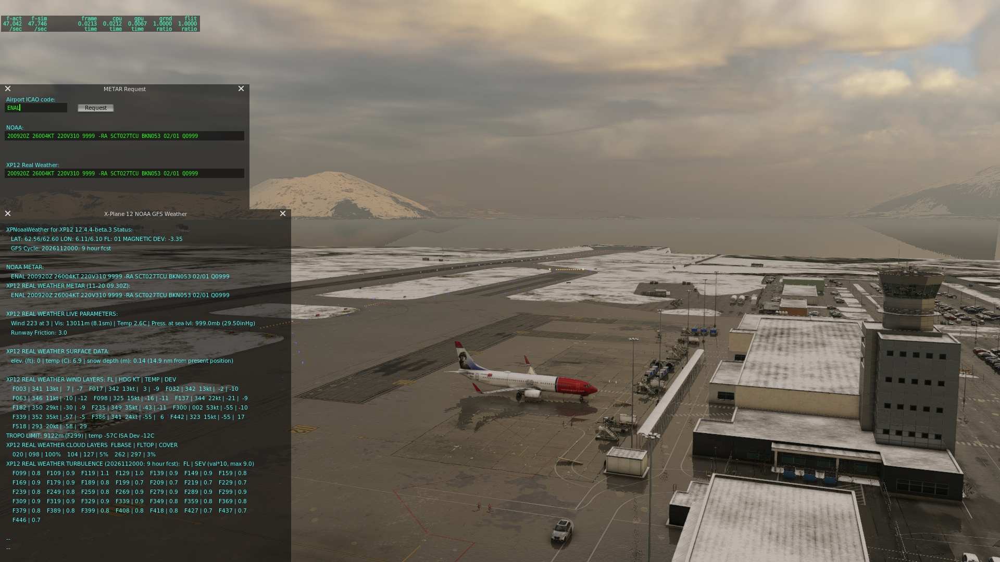

# [XPGFS] NOAA Global Weather (X-Plane 12)



NOAAWeather is an [XPPython3](https://xppython3.readthedocs.io/en/latest/index.html) plugin that works alongside the X-Plane 12 Real Weather engine. It adds what the engine still lacks (snow cover, runway friction handling) and shows what Real Weather is doing.

It descends from the XPGFS NOAA Weather plugin created by [Joan](https://github.com/joanpc) ([original version](http://x-plane.joanpc.com/plugins/xpgfs-noaa-weather), not meant for X-Plane 12). [pbuckner](https://github.com/pbuckner) ported it to Python 3 ([his version](https://github.com/pbuckner/XplaneNoaaWeather)), and this version adapts it to X-Plane 12.

> [!IMPORTANT]
> XPPython3 (Python 3) cannot be used together with the old Python 2 interface and plugins.

## Features

Real Weather already downloads the GFS data, so this version no longer fetches it from NOAA. It concentrates on the parts the engine does not handle well:

- **Snow cover.** Since X-Plane 12.4.4 the Real Weather GRIB files contain snow depth (`SNOD`), but the engine does not render it correctly. With the feature enabled, the plugin applies snow cover from that data. Near coasts and over water, where there is no valid snow value at the aircraft position, it looks around the aircraft and ahead along the track for the nearest valid one.
- **Runway friction (tarmac treatment).** X-Plane 12 does not simulate tarmac treatment, so heavy icing conditions end up in runway friction and give a completely unrealistic result. The plugin lowers the slipperiness to keep grip in conditions where the airport would actually be operating.
- **Real Weather monitoring.** An overview of what the Real Weather engine is doing.
- **METAR window.** Shows the METAR from X-Plane 12 Real Weather next to the one from a chosen source (NOAA, IVAO or VATSIM servers).

> [!NOTE]
> Recent versions of AviTab no longer need the `METAR.rwx` file, so the function that writes it is deprecated.

> [!WARNING]
> Real Weather as a data source can give you information that differs from what other online pilots and ATC see: ATIS, runway in use and the weather itself may not match for anyone not using X-Plane 12. Real Weather METAR has improved a lot (XP12.05r1 and above) and is almost always up to date, but when flying online you are the one using different data, so be considerate of other users.

## Requirements

- **X-Plane 12.4.4 or above** (not tested with earlier versions, which probably do not work).
- **[XPPython3](https://xppython3.readthedocs.io/en/latest/index.html) 4.8.0 or above.** XPPython3 includes its own Python 3.12 and the libraries the plugin needs, so you do not have to install Python.
- MacOS 10.14, Windows 7 and Linux kernel 4.0 and above (tested using macOS 14.8.9)
- Internet access, for METAR data (and, when needed, GFS / WAFS).

> [!IMPORTANT]
> Since version 12.4.4-beta.4, NOAAWeather requires XPPython3 4.8.0 or above. If you still need an older XPPython3, use NOAAWeather 12.4 (not recommended).

**wgrib2** is included: the plugin ships with builds for macOS, Windows (the cygwin `.dll` is in the `bin` folder) and Linux, built on macOS Big Sur, Windows 11 and Ubuntu 20.04 LTS. There is nothing to install.

## Installation

Copy the `PI_NOAAWeather` folder into `X-Plane/Resources/plugins/PythonPlugins`. The result must look like this:

```
X-Plane/Resources/plugins/PythonPlugins/
└── PI_NOAAWeather/
    ├── PI_NOAAWeather.py
    ├── bin/
    ├── scripts/
    └── version.txt
```

The whole plugin lives inside its own folder. That keeps it self-contained and lets an updater manage it.

> [!WARNING]
> Delete any previous release completely, do not overwrite it. Older versions were not contained in a folder, so these must be removed first:
> - `X-Plane/Resources/plugins/PythonPlugins/noaaweather/`
> - `X-Plane/Resources/plugins/PythonPlugins/PI_noaaWeather.py`

### Automatic updates with the SkunkCrafts Updater

NOAAWeather can be kept up to date with the free [SkunkCrafts Updater](https://updater.skunkcrafts.com) instead of copying the folder by hand.

**What you need**

- **The updater**, in one of its two forms. Use one, not both:
  - the **standalone client ver. 4.2+**  (recommended): it runs outside X-Plane;
  - the **in-game plugin**: version 2.5 or newer, installed in `X-Plane/Resources/plugins/SkunkCraftsUpdater` (not tested, should work);
- **NOAAWeather installed once, by hand**, as described above. The updater recognises it through the `skunkcrafts_updater.cfg` file in the `PI_NOAAWeather` folder, so do not rename, move or delete it.

**Updating**

1. Close X-Plane.
2. Open the SkunkCrafts Updater and select your X-Plane folder (standalone client).
3. Update NOAAWeather when it is offered. Both Release and Beta channels are selectable in the updater interface.
4. Start X-Plane.

If something looks wrong after an update, delete the `PI_NOAAWeather` folder, install the latest release again by hand, and let the updater take over from there.

## How it works

When X-Plane starts, the plugin launches a small background process, the **weather server** (`weatherserver.py`). It downloads METARs, reads the Real Weather GRIB files with wgrib2, and answers the plugin over UDP on `localhost` (port 8950 by default), so nothing is exposed to the network. The server stops when X-Plane exits, even if X-Plane crashes.

## Troubleshooting and reporting problems

If there is no weather data or the plugin misbehaves, look at the two log files:

| File | Contents |
|---|---|
| `XPPython3Log.txt` (in your X-Plane folder) | the plugin itself |
| `Resources/plugins/PythonPlugins/PI_NOAAWeather/weather_server_log.txt` | the weather server, rewritten at every start |

Beta versions (for example `12.4.4-beta.10`) write extra debug lines to both files. Release versions log only information, warnings and errors.

When you report a problem, please attach both logs and tell us your NOAAWeather version, X-Plane and XPPython3 versions, and your operating system.

If your firewall asks about the plugin, it is only the local connection between the plugin and its weather server.

## Under the hood

Recent versions concentrate on using fewer resources and on being easier to diagnose:

- **Weather data is read only when something changed.** Real Weather GRIB files come in two densities: 0.25° (snow depth, clouds, visibility, turbulence, ...) and 1° (wind, temperature, humidity, pressure, ground elevation). Each file is read again only when the aircraft enters a new tile of its own grid, or when X-Plane rewrites it (a new weather timeframe). In a test flight in Norway (including 30 minutes parked), 133 weather requests needed 338 GRIB file reads instead of 1,995, which is 83% fewer (76% fewer while moving). The snow search is cached the same way.
- **The weather server stays out of the simulator's way.** It runs as a separate, lower-priority process (a background process, not a thread inside X-Plane), and wgrib2 runs without a console window or a shell.
- **Safer communication.** The plugin and its server exchange JSON, never pickled objects.
- **Thread-safe METAR database.** Each thread uses its own SQLite connection.
- **Clear logging.** One logger, with levels. Beta versions log debug details and releases do not.

## Development

The plugin is developed against Python 3.12.1, the version XPPython3 ships on macOS (pinned in `.python-version`). The test suite uses [pytest](https://docs.pytest.org/) and [uv](https://docs.astral.sh/uv/):

```bash
uv sync
uv run pytest                        # everything
uv run pytest -m "not integration"   # only the fast unit tests
```

```
PI_NOAAWeather/     the plugin: what gets installed
tests/
├── unit/           configuration, METAR database, GRIB parsing, ...
├── integration/    plugin lifecycle in a fake X-Plane, and the real weather server process
├── fakes/          a fake `xp` module, so tests run without X-Plane
└── data/           static test data (for example a METAR CSV)
```

- Tests run without X-Plane and without a network connection: the `xp` module is faked, METAR downloads are replaced by a static CSV in `tests/data`, and any other network access fails the test.
- The integration tests load the plugin into a fake X-Plane folder and start the real `weatherserver.py` as a subprocess. They check that it starts, answers, shuts down on the plugin's request, and exits when X-Plane's pipe closes. If the server fails to start, the test report contains its stderr and log, which X-Plane would never show you.

## Credits and license

- Joan Perez i Cauhe: original XPGFS NOAA Weather plugin (2011-2020)
- Philip Buckner ([pbuckner](https://github.com/pbuckner)): Python 3 port and [XPPython3](https://xppython3.readthedocs.io/en/latest/index.html)
- Antonio Golfari: X-Plane 12 version (2021-2026)

This program is free software, released under the GNU General Public License, version 2 or (at your option) any later version.

## Resources

### NOAA

- GFS Products: http://www.nco.ncep.noaa.gov/pmb/products/gfs/
- GFS Inventory: http://www.nco.ncep.noaa.gov/pmb/products/gfs/gfs.t00z.pgrb2f06.shtml
- WAFS Inventory: http://www.nco.ncep.noaa.gov/pmb/products/gfs/WAFS_blended_2012010606f06.grib2.shtml
- NOMADS filter: http://nomads.ncep.noaa.gov/
- wgrib2: http://www.cpc.ncep.noaa.gov/products/wesley/wgrib2/

### OpenGrADS

Interactive desktop tool for easy access, manipulation and visualization of earth science data, with wgrib2 builds for several platforms: http://sourceforge.net/projects/opengrads/

### X-Plane

- Datarefs: https://developer.x-plane.com/datarefs/
- Some information on what X-Plane does with METAR data: http://code.google.com/p/fjccuniversalfmc/wiki/Winds
